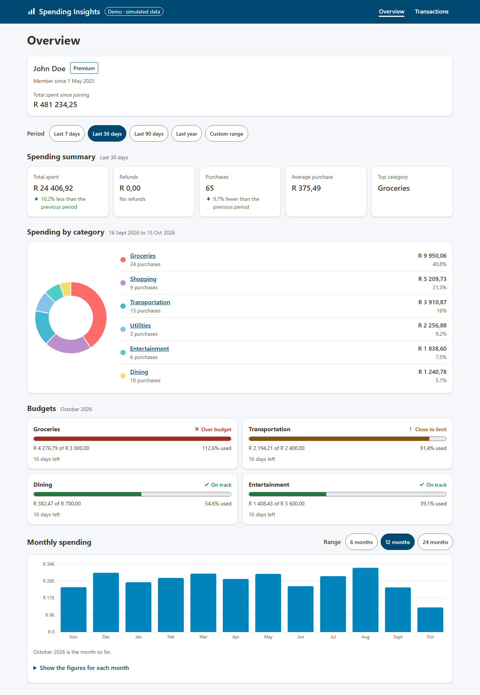
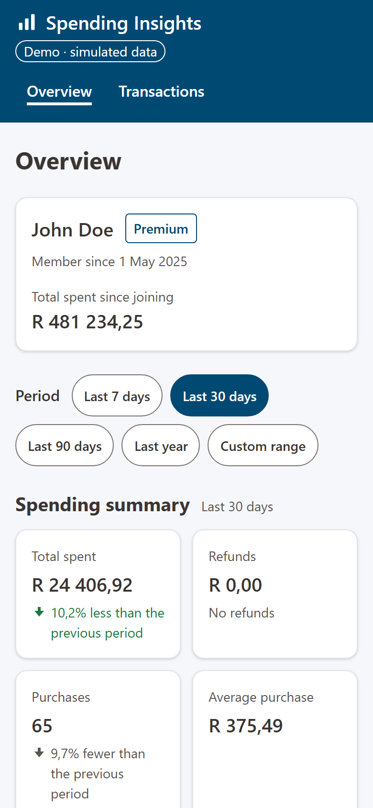
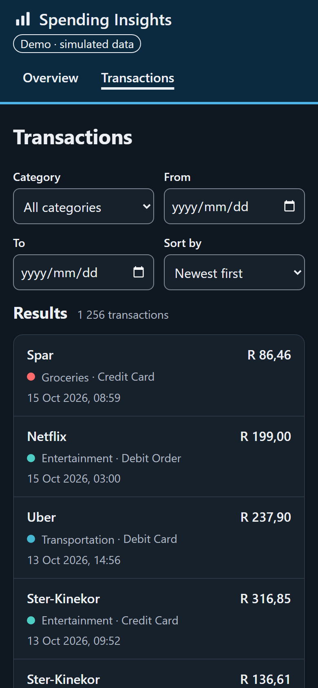
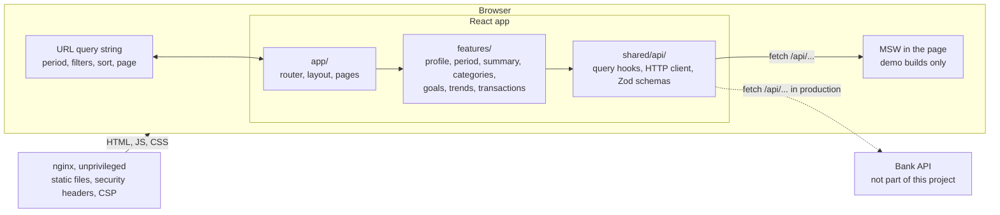

# Customer Spending Insights Dashboard

[](https://github.com/AndileDimba/spending-insights-dashboard/actions/workflows/ci.yml)
[](https://github.com/AndileDimba/spending-insights-dashboard/actions/workflows/security.yml)

A responsive dashboard that shows a bank customer's spending: a summary for a chosen period, spending by category, budgets, monthly trends and a filterable list of transactions. The data comes from a mocked API that follows the contract in [`docs/brief/api-spec.md`](docs/brief/api-spec.md).

**Live demo: [insights.dimba.co.za](https://insights.dimba.co.za)**, deployed from `main` ([ADR 0015](docs/adr/0015-demo-on-vercel.md)). The data is generated, seeded and relative to today, and the header says so.

| Desktop | Phone | Phone, dark theme |
| --- | --- | --- |
| [](docs/screenshots/readme-overview-desktop.png) | [](docs/screenshots/readme-overview-mobile.png) | [](docs/screenshots/readme-transactions-mobile-dark.png) |

## Contents

- [What it does](#what-it-does)
- [Quick start](#quick-start)
- [Testing](#testing)
- [Commands](#commands)
- [Architecture](#architecture)
- [Security](#security)
- [How it was built](#how-it-was-built)
- [Trade-offs and known limitations](#trade-offs-and-known-limitations)
- [Next steps](#next-steps)
- [Project documentation](#project-documentation)

## What it does

- **Overview:** the customer's profile, then a period selector (last 7, 30 or 90 days, last year or a custom range) that drives the spending summary and the category breakdown. Purchases and refunds are reported separately, so the summary, the categories and the transactions always add up ([A21](docs/api-assumptions.md#a21-purchases-and-refunds-in-totals)). Each change from the previous period is stated in words, not only by colour or an arrow.
- **Spending by category:** a donut chart beside the same data as a list, with each category linking to its transactions.
- **Budgets:** progress against each goal, with its status as a word and an icon as well as a colour.
- **Monthly spending:** a bar chart over 6, 12 or 24 months, with the figures for each month in a table below it.
- **Transactions:** a table on wide screens and a list on phones, filtered by category and dates, sorted, and paged 20, 50 or 100 at a time.
- **Shareable state:** the period, filters, sort and page live in the URL, so a link, a reload or the back button gives the same view.
- **Every data view has four states:** loading (a skeleton the size of the content), empty, an error with "Try again", and the data. While new data loads, the current figures stay on screen, still labelled with their own period and marked "Updating".
- **Accessible:** keyboard navigable, with a skip link, visible focus, labelled controls, WCAG AA contrast in both themes, a text or table alternative for every chart, and changes announced to screen readers.

## Quick start

### With Docker

The only prerequisite is Docker.

```bash
docker build -t spending-insights .
docker run --rm -p 8080:8080 spending-insights
```

Open <http://localhost:8080>. The image builds the app and serves it from unprivileged nginx with the security headers and Content Security Policy ([ADR 0012](docs/adr/0012-unprivileged-nginx-runtime.md)). It is a demo build with the mock API inside it. If port 8080 is taken, map another one, for example `-p 8081:8080`.

The container runs unchanged under the restrictions a hardened platform applies, which is how CI runs it:

```bash
docker run --rm -p 8080:8080 --read-only --tmpfs /tmp \
  --cap-drop ALL --security-opt no-new-privileges spending-insights
```

In Git Bash on Windows, put `MSYS_NO_PATHCONV=1` before that command, or Git Bash turns `/tmp` into a Windows path and Docker rejects it.

To check a running container (headers, caching, deep links, 404s and the health check), run `sh scripts/docker-smoke-test.sh http://localhost:8080`.

### With npm

Prerequisites: Node.js 24.15 or later in the 24 line (see [`.nvmrc`](.nvmrc)) and npm 11. Installs fail on other Node versions on purpose (`engine-strict`).

```bash
npm ci            # install exactly what the lockfile specifies
npm run dev       # development server at http://localhost:5173, with the mock API
npm test          # unit, contract and component tests
```

### The mock API

There is no real backend. The API is mocked at the network layer with [MSW](https://mswjs.io/) ([ADR 0008](docs/adr/0008-msw-network-layer-mocking.md)): the app makes real `fetch` calls, and MSW answers them inside the page ([ADR 0016](docs/adr/0016-in-page-mocks.md)) with about 18 months of seeded South African transactions for one customer. Every endpoint is derived from the same data, so the numbers agree across views. The same handlers serve the tests.

| Build | Mock API |
| --- | --- |
| `npm run dev` | Always on |
| `npm run build` | Off: the mocks are not bundled, and CI checks that they are absent |
| `VITE_ENABLE_MOCKS=true npm run build` | On |
| Docker image | On by default; `--build-arg VITE_ENABLE_MOCKS=false` for a real deployment |

To see the other states, add a scenario to any page's address:

| Address | What you see |
| --- | --- |
| `?mock=slow` | The loading skeletons, for 2.5 seconds |
| `?mock=empty` | The empty states |
| `?mock=error` | The error states; "Try again" fails again |
| `?mock=recover` | The error states, after the automatic retries are used up; "Try again" then loads the data |

For example, [insights.dimba.co.za/?mock=recover](https://insights.dimba.co.za/?mock=recover).

## Testing

The project is built test-first ([ADR 0003](docs/adr/0003-test-driven-development.md)): each acceptance criterion in an issue starts as a failing test named after it, and each bug starts as a test that reproduces it. Tests use the page the way a customer does, by role, label and visible text. The full approach is in [`docs/testing-strategy.md`](docs/testing-strategy.md).

| Layer | What it proves | Run it with |
| --- | --- | --- |
| Static | TypeScript strict with no `any`; ESLint with type-aware, React hooks, accessibility and Testing Library rules; feature boundaries enforced by lint | `npm run typecheck`, `npm run lint` |
| Unit and contract | Formatting, dates, URL parsing and the data generator are correct at the edges; the summary, categories and transactions reconcile for every period; every example in the API spec and every mock response parses | `npm test` |
| Component | Each view works in all four states against the mock API, with axe finding no accessibility violations | `npm test` |
| Security | Injection strings render as text, malformed API data shows an error and never a wrong number, tampered URL parameters fall back to safe values | `npm test`, `npm run test:e2e` |
| End-to-end | The critical journeys work in desktop Chromium, Chromium at 360px and WebKit as an iPhone, with an axe scan on every page. Any console error, uncaught error or CSP violation fails a test | `npm run test:e2e` |
| Mutation | The tests catch faults, not only run lines, in `src/shared/lib` and `src/shared/api` | `npm run test:mutation` (see below) |

Tests are deterministic: seeded data, a fixed clock, tests in UTC, and no real network. A request without a mock handler fails the test.

**Coverage:** `npm run test:coverage` writes a report to `coverage/index.html`. CI requires 80% overall and 95% in `src/shared/lib` and `src/shared/api`, where money, dates and validation live.

**End-to-end:** install the browsers once with `npx playwright install chromium webkit`. Without `E2E_BASE_URL`, `npm run test:e2e` builds the demo and serves it with `vite preview`; the security header tests are skipped there, because only nginx sends the headers. To test a running container instead, behind nginx and its headers (which is what CI does):

```bash
docker run -d --name spending-insights -p 8080:8080 spending-insights
E2E_BASE_URL=http://localhost:8080 npm run test:e2e
docker rm -f spending-insights
```

**Mutation:** Stryker's Vitest runner does not yet support Vitest 5 ([stryker-js#6210](https://github.com/stryker-mutator/stryker-js/issues/6210)), so the mutation run uses Vitest 4 without saving it. CI does the same; `npm ci` restores Vitest 5 afterwards.

```bash
npm install --no-save vitest@4.1.11 @vitest/coverage-v8@4.1.11
npm run test:mutation    # report in reports/mutation/index.html
```

The score must be at least 90%; it was 100% for v0.4.0.

## Commands

| Task | Command |
| --- | --- |
| Install | `npm ci` |
| Development server, with the mock API | `npm run dev` |
| Typecheck | `npm run typecheck` |
| Lint (zero warnings allowed) | `npm run lint` |
| Fix lint issues that can be fixed automatically | `npm run lint:fix` |
| Format | `npm run format` |
| Check formatting | `npm run format:check` |
| Tests | `npm test` |
| Tests in watch mode (for TDD) | `npm run test:watch` |
| Tests with a coverage report | `npm run test:coverage` |
| End-to-end tests | `npm run test:e2e` |
| Mutation tests (see [Testing](#testing)) | `npm run test:mutation` |
| Production build into `dist/`, without mocks | `npm run build` |
| Check the JavaScript budgets | `npm run check:bundle` |
| Preview the production build | `npm run preview` |
| Docker build | `docker build -t spending-insights .` |
| Docker run | `docker run --rm -p 8080:8080 spending-insights` |

## Architecture

A single-page app in React 19, strict TypeScript and Vite ([ADR 0005](docs/adr/0005-react-vite-typescript-spa.md)), served as static files.



The decisions that shape it, each with the options considered in its [ADR](docs/adr/README.md):

- **Feature folders with one-way imports** ([ADR 0006](docs/adr/0006-feature-folders.md)). `app` composes `features`, features use `shared`, and a feature never reaches into another's internals. Lint enforces it. The layout is described in [`src/README.md`](src/README.md).
- **Server state in TanStack Query, UI state in the URL, no global store** ([ADR 0007](docs/adr/0007-server-state-and-url-state.md)). The API is the source of truth for data and the URL for what the customer is looking at, so there is nothing left to put in a store.
- **One API layer** in `src/shared/api/`: for each endpoint, a Zod schema, a typed fetcher and a query hook with a key factory. Components never call `fetch`.
- **Validation at the boundary** ([ADR 0009](docs/adr/0009-zod-validation-at-the-api-boundary.md)). Every response is parsed by Zod before the app sees it; types are inferred from the schemas, so they cannot drift apart.
- **Money as integer cents** ([ADR 0013](docs/adr/0013-money-as-integer-cents.md)). Amounts become a branded `Cents` type at the boundary, all arithmetic is in cents, and rand appear only in the en-ZA formatter.
- **Mocks at the network layer** ([ADR 0008](docs/adr/0008-msw-network-layer-mocking.md), [ADR 0016](docs/adr/0016-in-page-mocks.md)), so the app runs the same code it would against a real API, and replacing the mock is a build flag.
- **Charts with accessible alternatives** ([ADR 0011](docs/adr/0011-recharts-with-accessible-alternatives.md)), loaded on demand so they do not slow the first page.
- **CSS Modules and design tokens** ([ADR 0010](docs/adr/0010-css-modules-and-design-tokens.md)), with a Capitec-inspired palette whose every colour pair is checked for contrast by a test ([ADR 0014](docs/adr/0014-capitec-inspired-palette.md)).

Where the API contract left gaps (the sign of a refund, what an unknown goal status means, which dates a period covers), each decision is recorded in [`docs/api-assumptions.md`](docs/api-assumptions.md) with its reasoning and the question for the backend team.

### Performance

Each page's code loads on its own and the first page's code is preloaded. CI fails a pull request that takes the app shell over 120 KB of gzipped JavaScript or the dashboard over 250 KB. On a simulated mid-range phone, Lighthouse scores the demo image, which loads its data from the mock API, 90 to 91 for performance and 100 for accessibility. The production image scores 95, but it has no backend, so it was measured showing an error state: it shows how fast the page itself arrives, not a loaded dashboard. The [performance report](docs/performance/README.md) has the measurements.

## Security

Banking data is sensitive, and the API is treated as untrusted. The threats and the test that proves each mitigation are in the [threat model](docs/discovery/threat-model.md).

- **In the app:** every response is validated, and malformed data shows an error, never a wrong figure. React escapes everything it renders and `dangerouslySetInnerHTML` is not used. URL parameters are parsed against the values the contract allows before they reach a request. The customer's email is never shown, and logs carry no personal or financial data.
- **In the image:** a strict Content Security Policy with no inline scripts and no framing, `X-Content-Type-Options`, `Referrer-Policy`, `Permissions-Policy` and `Cross-Origin-Opener-Policy`. HTTPS and HSTS belong to whatever terminates TLS in front of the container. nginx runs as a non-root user and works with a read-only filesystem and all capabilities dropped. The base images are pinned to digests.
- **Proven by tests:** the end-to-end tests check the headers and fail on any CSP violation; component tests render injection strings and malformed data.
- **In the pipeline:** `npm audit` and registry signature checks, CodeQL, a Trivy scan of the image, Dependabot with a cooldown, secret scanning with push protection, actions pinned to commit SHAs, installs without lifecycle scripts, and read-only workflow tokens.

To report a vulnerability, see [`SECURITY.md`](SECURITY.md).

## How it was built

The way a team would build it, so the history can be reviewed:

- **Git Flow** ([ADR 0002](docs/adr/0002-git-flow-branching.md), [`CONTRIBUTING.md`](CONTRIBUTING.md)). Every change is an issue with acceptance criteria, a branch named after it and a pull request into `develop`. Releases go through `release/x.y.z` branches into `main`, are tagged, and are merged back. `main` and `develop` are protected, and a local hook stops direct commits to them.
- **Conventional Commits**, checked on every pull request, with each commit leaving the build green.
- **Eleven required checks** on every pull request: PR conventions, lint and format, typecheck, unit tests with coverage, the build with its mock and budget checks, the Docker image with its smoke test, end-to-end tests against that image, and the security scans.
- **Milestones and releases** follow the [roadmap](docs/roadmap.md), and each release is described in the [changelog](CHANGELOG.md). Bugs that testers found on real phones were each reproduced by a failing test before the fix.

## Trade-offs and known limitations

- **No authentication.** The brief is a frontend with mocked data for one customer, so there is no sign-in or session handling. It is the largest gap between this and production, and it is the first item in the threat model's residual risks.
- **The demo image contains the mock API.** It is what makes the image runnable on its own. A real deployment builds with `VITE_ENABLE_MOCKS=false` and points at the API; CI proves that build has no mock code.
- **Client-side validation protects the customer's screen, not the backend,** which must validate its own input.
- **The demo is slightly slower than production.** The mock API loads before the first render, so the demo image misses the 2.5 s Largest Contentful Paint target by 0.1 to 0.2 s. The production image meets it.
- **No visual regression tests.** They need a stable environment for the baseline images. Layout is covered by component, axe and end-to-end tests, including a check for horizontal scrolling at 360px.
- **iPhone native controls are not fully covered by automation.** WebKit in Playwright is not iOS Safari, so iPhone fixes such as the date inputs are also checked on real iPhones by testers.
- **Two temporary workarounds:** Vitest 4 for the mutation run, and the WebKit tests ignoring a WebKit bug that reports every `<select>` as a CSP violation. The WebKit one has a test that fails once WebKit is fixed; the Vitest one goes when Stryker supports Vitest 5.

## Next steps

With a real backend and more time, in order:

1. **Connect a real API** with authentication (OpenID Connect with PKCE, tokens kept out of JavaScript through a backend for frontend), and remove the mock API from production images.
2. **Visual regression tests** for both themes at the supported widths, in a pinned container.
3. **Real user monitoring** of Core Web Vitals and errors, without personal data, to check the Lighthouse results on real phones and networks.
4. **Merchant search** ([#28](https://github.com/AndileDimba/spending-insights-dashboard/issues/28)), which needs a contract change.
5. **CSV export** of filtered transactions, with protection against formula injection ([#29](https://github.com/AndileDimba/spending-insights-dashboard/issues/29)).
6. **A reference API in ASP.NET Core** implementing the same contract, run with the frontend through Docker Compose ([#30](https://github.com/AndileDimba/spending-insights-dashboard/issues/30), [ADR 0004](docs/adr/0004-reference-backend-in-aspnet-core.md)).

## Project documentation

| Document | Purpose |
| --- | --- |
| [`docs/brief/project-brief.md`](docs/brief/project-brief.md) | The brief and scope |
| [`docs/brief/api-spec.md`](docs/brief/api-spec.md) | API contract |
| [`docs/api-assumptions.md`](docs/api-assumptions.md) | Gaps in the contract and how they were resolved |
| [`docs/discovery/non-functional-requirements.md`](docs/discovery/non-functional-requirements.md) | Measurable targets for performance, accessibility, security, privacy and more |
| [`docs/discovery/threat-model.md`](docs/discovery/threat-model.md) | STRIDE threat model, security headers and residual risks |
| [`docs/discovery/wireframes.md`](docs/discovery/wireframes.md) | Information architecture and responsive layouts |
| [`docs/testing-strategy.md`](docs/testing-strategy.md) | Test-driven development, test layers, security tests and quality gates |
| [`docs/performance/`](docs/performance/README.md) | Bundle budgets and Lighthouse results for the production and demo images, with the reports |
| [`docs/adr/`](docs/adr/README.md) | Architecture decision records, with an index |
| [`docs/roadmap.md`](docs/roadmap.md) | Delivery plan |
| [`src/README.md`](src/README.md) | Source layout and import rules |
| [`CONTRIBUTING.md`](CONTRIBUTING.md) | Branching, commits, pull requests, and the definitions of ready and done |
| [`SECURITY.md`](SECURITY.md) | Reporting a vulnerability, and the protections in place |
| [`CHANGELOG.md`](CHANGELOG.md) | Release history |

## Licence

[MIT](LICENSE)

This is an independent project written for a job application. It is not affiliated with, endorsed by or connected to Capitec Bank. The colour palette is inspired by Capitec's, and no Capitec name, logo or other trademark is used ([ADR 0014](docs/adr/0014-capitec-inspired-palette.md)).
